<!-- Profile cards generated by render.py -->

<picture><source media="(prefers-reduced-motion: reduce)" srcset="cards/still/hero.svg"></picture>

<a href="https://github.com/here-2007?tab=repositories"><picture><source media="(prefers-reduced-motion: reduce)" srcset="cards/still/link-repositories.svg"></picture></a><a href="https://huggingface.co/Pernav"><picture><source media="(prefers-reduced-motion: reduce)" srcset="cards/still/link-hugging-face.svg"></picture></a><a href="https://www.kaggle.com/pernavjain"><picture><source media="(prefers-reduced-motion: reduce)" srcset="cards/still/link-kaggle.svg"></picture></a>

<picture><source media="(prefers-reduced-motion: reduce)" srcset="cards/still/monthly.svg"></picture>

<a href="https://github.com/here-2007/SQL_Engine"><picture><source media="(prefers-reduced-motion: reduce)" srcset="cards/still/repo-sql-engine.svg"></picture></a>

<a href="https://github.com/here-2007/Customer-Support-Ticket-Dispatcher"><picture><source media="(prefers-reduced-motion: reduce)" srcset="cards/still/repo-customer-support-ticket-dispatcher.svg"></picture></a>

<a href="https://github.com/here-2007/Traffic-Congestion-Project"><picture><source media="(prefers-reduced-motion: reduce)" srcset="cards/still/repo-traffic-congestion-project.svg"></picture></a>

<a href="https://github.com/here-2007/Customer-Personality-Analyser"><picture><source media="(prefers-reduced-motion: reduce)" srcset="cards/still/repo-customer-personality-analyser.svg"></picture></a>

<a href="https://github.com/here-2007/House-Pricing"><picture><source media="(prefers-reduced-motion: reduce)" srcset="cards/still/repo-house-pricing.svg"></picture></a>

<a href="https://github.com/here-2007/Loan-Risk"><picture><source media="(prefers-reduced-motion: reduce)" srcset="cards/still/repo-loan-risk.svg"></picture></a>

<a href="https://github.com/here-2007#year-list-container"><picture><source media="(prefers-reduced-motion: reduce)" srcset="cards/still/calendar.svg"></picture></a>

<!-- End profile cards -->
